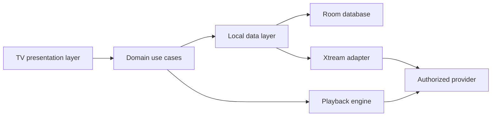

# TCL Google TV Xtream Player
## Local Backend Architecture Specification

**Status:** Architecture baseline for implementation  
**Platform:** TCL televisions running Google TV / Android TV  
**Scope:** Fully local Xtream-compatible player; no application cloud backend  
**Language:** Kotlin  

## 1. Architectural decision

The application backend will run entirely inside the Android TV application. It will connect directly to an authorized Xtream-compatible provider for authentication, catalog metadata, EPG data, artwork, and media streams.

There will be no Node.js service, hosted database, stream proxy, or application account server in the first release.



The UI must never depend on raw Xtream responses. It consumes stable domain models and observable local database queries. This boundary is the main protection against inconsistent providers.

## 2. Quality goals

In priority order:

1. Continue browsing cached content when the provider API is slow or unavailable.
2. Handle inconsistent Xtream response shapes without crashing.
3. Start playback quickly without proxying media.
4. Keep memory use predictable on low-resource televisions.
5. Never expose provider credentials through logs, analytics, database fields, or UI errors.
6. Recover safely from interrupted synchronization and application termination.
7. Make every backend component testable without a television or live provider.

## 3. Recommended module structure

Use a Gradle multi-module project. Avoid premature micro-modules; the following boundaries are sufficient.

| Module | Responsibility | May depend on |
| --- | --- | --- |
| `:app` | Android entry point, dependency assembly, navigation host | All feature and core modules |
| `:core:domain` | Pure Kotlin models, repository contracts, use cases, error types | Nothing Android-specific |
| `:core:xtream` | HTTP client, DTOs, tolerant parsing, endpoint behavior, URL construction | `:core:domain`, network libraries |
| `:core:database` | Room entities, DAOs, migrations, transactions, FTS search | `:core:domain` |
| `:core:data` | Repository implementations, mapping, refresh orchestration | Domain, Xtream, database, security |
| `:core:security` | Credential encryption and redaction | Android Keystore APIs |
| `:core:playback` | Media3 player lifecycle, source selection, recovery, playback metrics | Domain, Media3 |
| `:core:sync` | WorkManager jobs, refresh policies, backoff and sync state | Data, domain |
| `:core:testing` | Fixtures, fake provider, malformed-response corpus, test utilities | Domain and test dependencies |
| `:feature:*` | Future TV screens and presentation state | Domain/use-case APIs only |

Rule: feature modules cannot import Xtream DTOs, Room entities, Retrofit services, or credential storage classes.

## 4. Technology choices

| Concern | Choice | Reason |
| --- | --- | --- |
| HTTP | OkHttp + Retrofit | Mature cancellation, interceptors, timeouts and Media3 integration |
| JSON | Moshi with custom tolerant adapters | Accept string/number/boolean/null variations explicitly |
| Database | Room + SQLite | Transactional local source of truth and migrations |
| Search | SQLite FTS4/FTS5, based on device support through Room | Avoid loading catalogs into memory |
| Concurrency | Kotlin coroutines and Flow | Structured cancellation and observable queries |
| Background work | WorkManager | Durable constrained refresh jobs |
| Playback | AndroidX Media3 / ExoPlayer | Android-supported playback stack |
| Credentials | Android Keystore-backed encryption | Credentials must not be stored as plaintext |
| DI | Hilt | Standard Android lifecycle-aware dependency wiring |
| Images | Coil | Disk/memory caching with bounded TV-friendly configuration |

Do not introduce Ktor server, Express, Docker, Redis, PostgreSQL, or GraphQL. They solve problems this local application does not have.

## 5. Domain model

Raw provider objects are mapped into these stable concepts:

- `ProviderAccount`
- `SubscriptionStatus`
- `ContentCategory`
- `LiveChannel`
- `Movie`
- `Series`
- `Season`
- `Episode`
- `EpgProgram`
- `Favorite`
- `PlaybackProgress`
- `WatchHistoryEntry`
- `SyncStatus`
- `PlaybackSource`

All IDs are scoped by `accountId`. Provider IDs are not globally unique.

Use application-generated UUIDs for account identity. Preserve provider IDs as strings even when a server returns a number. This prevents overflow and string/integer incompatibilities.

## 6. Local database design

### Core tables

| Table | Important fields |
| --- | --- |
| `accounts` | `id`, display name, normalized base URL, encrypted-credential reference, status, expiry, output formats, last authentication time |
| `live_categories` | `account_id`, provider category ID, name, sort order, hidden flag |
| `live_channels` | account/category IDs, provider stream ID, name, icon URL, EPG ID, archive capability, ordering, metadata hash |
| `movies` | account ID, stream ID, name, extension, artwork, rating, release metadata, metadata hash |
| `series` | account ID, series ID, title, artwork, rating, last modified, detail state |
| `seasons` | account/series IDs, provider season number, title, artwork |
| `episodes` | account/series/season IDs, episode ID, title, extension, duration, metadata |
| `epg_programs` | account/channel IDs, provider event ID if present, start/end instants, title, description |
| `favorites` | account ID, content type, stable content key, created time |
| `playback_progress` | account ID, content key, position, duration, completed flag, updated time |
| `watch_history` | account ID, content key, last watched time, play count |
| `sync_runs` | account ID, scope, state, started/finished times, counts and sanitized error code |

### Database rules

- Composite unique indexes must include `account_id` and provider ID.
- Index live-category browsing, EPG time ranges, history ordering and content lookup.
- Do not store movie or TV-show category IDs, names, mappings, or category responses.
- Use foreign keys with account-level cascade deletion.
- Use FTS tables for normalized titles; do not search Kotlin lists.
- Write imports in bounded transactions/batches rather than one transaction covering an enormous catalog.
- Maintain `last_seen_sync_id` or equivalent generation markers to remove stale provider records only after a successful scope refresh.
- Preserve favorites and history independently of catalog refreshes.
- Keep only a rolling EPG window, initially 2 days past and 7 days future, configurable after device testing.

## 7. Credential and network security

### Credential storage

- Store username and password in encrypted application storage using a key protected by Android Keystore.
- The database stores only a credential reference, never plaintext credentials.
- Do not put credentials in WorkManager input data, saved state, intents, deep links, or crash metadata.
- Clear credential character arrays/intermediate values where practical after request construction.
- Deleting an account deletes its credentials, cached catalog, EPG and personal state in one user-confirmed operation.

### URL and log redaction

All API and playback URLs can contain credentials. A single central redactor must sanitize:

- `username` and `password` query parameters;
- `/live/{username}/{password}/...`;
- `/movie/{username}/{password}/...`;
- `/series/{username}/{password}/...`;
- authorization headers and provider response samples.

Release builds must not use HTTP body logging. Error records contain a stable error code, endpoint type, HTTP status when safe, attempt count and timing—not the full URL or response body.

### HTTP policy

- Prefer HTTPS.
- Support HTTP only because many compatible providers require it.
- Do not disable TLS certificate verification.
- Do not implement trust-all certificates.
- Apply cleartext policy as narrowly as Android permits and visibly warn when an account uses HTTP.
- Block loopback, link-local and private-network provider addresses by default if arbitrary accounts can be imported from untrusted sources; allow an explicit local-network setting when legitimately required.

## 8. Xtream compatibility adapter

The adapter owns all legacy behavior.

### Supported capabilities

- Authentication and server/user information
- Live TV categories only
- Live streams
- VOD streams and details
- Series list and lazy series details
- Short EPG where supported
- XMLTV EPG fallback
- Live/VOD/episode playback URL construction
- Allowed output format selection
- Catch-up metadata detection; playback can be a later feature flag

The adapter must not call `get_vod_categories` or `get_series_categories`. If a provider embeds movie or TV-show category fields inside catalog responses, the DTO layer ignores them during parsing and they are never mapped into domain models or database entities.

### Parsing policy

- Accept numeric fields as JSON number or numeric string.
- Accept booleans as boolean, `0/1`, or `"0"/"1"`.
- Treat absent, empty and explicit-null optional fields consistently.
- Preserve unknown enum values rather than failing the response.
- Parse Unix timestamps as seconds with overflow checking; never infer milliseconds silently without a documented heuristic and test.
- Resolve relative artwork URLs safely against the normalized provider origin.
- Reject HTML error pages and malformed successful responses with typed errors.
- Set upper bounds for response size, nesting and string lengths to prevent memory exhaustion.

### URL construction

A dedicated `PlaybackUrlFactory` creates URLs only at the moment they are needed. Full credential-bearing playback URLs must never be persisted.

It chooses:

1. Provider-advertised output format.
2. Content-specific `container_extension` when present.
3. Tested fallback formats for that content type.

The player receives the URL in memory and all diagnostic output passes through redaction.

## 9. Repository contracts

The presentation layer will eventually depend on interfaces such as:

```kotlin
interface AccountRepository {
    suspend fun addAndValidate(input: NewAccount): Result<AccountId>
    fun observeAccounts(): Flow<List<ProviderAccount>>
    suspend fun remove(accountId: AccountId)
}

interface CatalogRepository {
    fun observeLiveCategories(accountId: AccountId): Flow<List<ContentCategory>>
    fun observeChannels(accountId: AccountId, categoryId: String): Flow<List<LiveChannel>>
    fun search(accountId: AccountId, query: String, filter: ContentFilter): Flow<List<SearchResult>>
    suspend fun refresh(accountId: AccountId, scope: RefreshScope): RefreshResult
}

interface PlaybackRepository {
    suspend fun resolve(content: PlayableContent): Result<PlaybackSource>
    suspend fun recordProgress(event: PlaybackProgressEvent)
}
```

Use cases enforce business rules: validate account, refresh catalog, observe home content, toggle favorite, search, load series details, resolve playback source, record progress and clean old EPG.

## 10. Synchronization strategy

### Initial account import

1. Normalize and validate the server URL.
2. Authenticate with strict timeouts.
3. Validate account status and expiry.
4. Store encrypted credentials only after successful authentication.
5. Import live TV categories.
6. Import live, movie and TV-show catalog scopes independently; discard any movie or TV-show category fields on arrival.
7. Commit each successful scope and expose progress.
8. Schedule EPG after live channels exist.
9. Mark the account usable even if an optional scope fails.

### Regular refresh

- Manual refresh: immediate coroutine-driven work while the app is active.
- Durable refresh: unique WorkManager job per account and scope.
- Catalog target: approximately every 12–24 hours, subject to TV power behavior.
- EPG target: approximately every 6–12 hours, plus manual refresh.
- Authentication check: during refresh and after authorization failures.
- Series details: fetch lazily when a series opens, then cache with a stale policy.

### Failure rules

- Never erase working cached content because a refresh returned an error or empty malformed response.
- A legitimately empty provider scope becomes authoritative only after validation.
- Retry timeouts, connection failures, selected 5xx responses and rate limiting.
- Do not retry invalid credentials, expired accounts, unsupported endpoints or deterministic parse failures endlessly.
- Use exponential backoff with jitter and cap attempts.
- Cancel superseded refreshes by unique work name.
- Surface stale-data state without blocking cached browsing.

## 11. Playback architecture

`PlayerCoordinator` owns a single Media3 player for the active application process.

Responsibilities:

- Resolve the credential-bearing URL just in time.
- Select live versus on-demand media configuration.
- Apply bounded live and VOD buffer policies based on device testing.
- Retry recoverable network failures without infinite loops.
- Attempt a safe alternate advertised container when the first source fails before media starts.
- Record time to first frame, rebuffer count/time, decoder name and sanitized terminal error.
- Save VOD/episode progress periodically and on stop.
- Do not save progress for ordinary live playback.
- Release decoders promptly when playback ends or the app is backgrounded as required.

Do not permanently cache live or VOD media in version one. Cache metadata and artwork only. Media caching can violate provider rules, consume scarce TV storage and create eviction complexity.

## 12. Error model

All layers map failures to stable domain errors:

| Category | Examples |
| --- | --- |
| `AccountError` | Invalid credentials, expired, disabled, connection limit |
| `NetworkError` | DNS, timeout, offline, TLS, HTTP status, cleartext blocked |
| `ProviderError` | Malformed response, incompatible schema, missing capability |
| `StorageError` | Database full, corruption, migration failure |
| `PlaybackError` | Source unavailable, unsupported codec/container, decoder failure |
| `SyncError` | Partial import, cancelled, retry exhausted |

Each error has a machine code, safe user message key, retryability and optional sanitized diagnostics. UI wording remains a presentation responsibility.

## 13. Performance budgets

These are initial engineering targets and must be measured on a representative low-end TCL TV:

- No network or database work on the main thread.
- UI queries return the first cached page within 200 ms under normal database size.
- Backend must not materialize the full channel/VOD/series catalog as one in-memory list.
- Database writes occur in bounded batches, initially 250–1,000 rows and tuned by evidence.
- Search is database-backed and cancellable.
- Artwork caches have explicit memory and disk limits.
- Initial import reports progressive usable states rather than blocking until every scope finishes.
- Application remains functional with at least 50,000 catalog items and a seven-day EPG test dataset.

## 14. Observability without a cloud service

Maintain a small local diagnostic ring buffer containing:

- Operation type and timestamps
- Duration
- Result/error code
- Item counts
- Retry count
- Playback startup and buffering metrics
- Device/API/app versions

Never store credentials, full URLs, titles watched, raw provider bodies or account usernames. Provide a user-controlled export later that previews exactly what will be shared.

## 15. Testing strategy

### Unit tests

- Tolerant JSON adapters for every type variation.
- URL normalization and playback URL construction.
- Credential redaction with adversarial URL forms.
- Timestamp/time-zone conversion.
- Refresh generation and stale-record deletion.
- Retry classification and backoff.
- EPG/channel matching.

### Integration tests

- Room DAOs, indexes and migrations.
- Transaction rollback during interrupted imports.
- MockWebServer endpoint behavior, timeouts, HTTP errors and oversized bodies.
- Multi-account isolation.
- WorkManager uniqueness and cancellation.

### Compatibility corpus

Keep sanitized fixtures representing:

- Canonical responses
- Strings versus numeric fields
- Missing/null fields
- Empty arrays and empty objects
- HTML/error text returned with HTTP 200
- Duplicate IDs
- Very large catalogs
- Invalid timestamps and extensions
- Short EPG and XMLTV variations

### Device tests

Test on a representative TCL television, Android TV emulator and one constrained physical Android TV device. Measure cold import, warm launch, live-category navigation, unified movie and TV-show browsing, search, channel switching, decoder compatibility, memory pressure, process death and recovery.

## 16. Database migration and recovery

- Every schema release includes automated forward migration tests.
- Never use destructive migration in production for user state.
- Catalog and EPG data are reconstructable; favorites, account references and playback history are not.
- If catalog tables are corrupted, isolate and rebuild reconstructable data without deleting credentials or personal state.
- Export/import of local settings is excluded from version one until credentials can be handled safely.

## 17. Implementation sequence

### Phase 1 — Foundation

- Gradle modules and dependency boundaries
- Domain models and typed errors
- Credential vault and redactor
- Room schema, DAOs and migrations
- Fake repositories for UI development

### Phase 2 — Xtream compatibility

- URL normalization and authentication
- Tolerant DTO parsing
- Categories and catalog endpoints
- Details, EPG and playback URL factory
- Mock provider plus compatibility fixtures

### Phase 3 — Offline-first data

- Repository implementations
- Transactional/batched imports
- Search, favorites, history and progress
- WorkManager refresh and cleanup

### Phase 4 — Playback core

- Media3 coordinator
- Format selection and safe fallback
- Reconnection and progress persistence
- Local playback diagnostics

### Phase 5 — Hardening

- Large-catalog load tests
- Process-death and low-storage recovery
- Provider compatibility tests
- Real TCL performance and codec validation

## 18. Decisions deferred to frontend discussion

The backend supports these without deciding their visual implementation:

- Account onboarding and validation progress
- Live TV category/channel browser
- EPG grid and current/next program display
- Unified Movies browsing without categories
- Unified TV Shows browsing without categories
- Global search
- Favorites, history and continue watching
- Playback controls and channel switching
- Account, refresh, parental and diagnostics settings

The product scope is a complete player: Live TV, Movies and TV Shows. Only Live TV uses provider categories. Movies and TV Shows are presented as unified catalogs with local search, sorting and optional derived filters; provider VOD/series categories are neither fetched nor stored.

## 19. Acceptance criteria for the local backend

The backend is ready for frontend integration when:

1. A valid account can be added without persisting plaintext credentials.
2. Cached content is observable immediately after relaunch without network access.
3. Two accounts with overlapping provider IDs remain isolated.
4. Malformed optional fields do not crash imports.
5. A failed refresh leaves the previous valid catalog intact.
6. Large fixtures import within measured memory and time budgets.
7. Search, favorites, history and progress work entirely from Room.
8. Live, movie and episode sources resolve without storing full playback URLs.
9. Logs and errors pass automated credential-leak tests.
10. Media3 playback and recovery are verified on a TCL Google TV.
