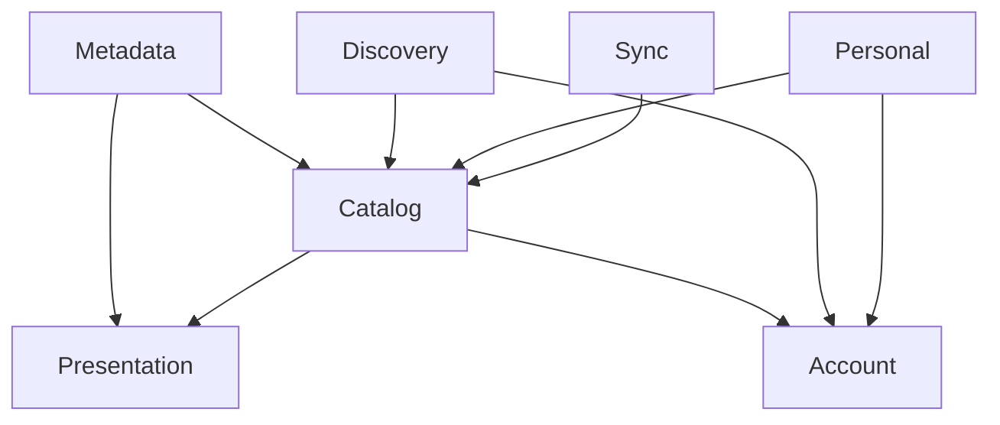

# L3 — Domain Layer

## 1. Scope and evidence

Requirements baseline for a Rust domain core of OH IPTV. README is product authority; observed Kotlin behavior is evidence, not automatically an approved requirement. No implementation changes. Source retrieved from `main`, not a pinned commit; no runtime tests executed.

Source root: https://github.com/OmranHakami/IPTV/blob/main/

Evidence keys (relative to `app/src/main/java/com/oh/tv/`): R = `data/OhRepository.kt`; E = `data/local/Entities.kt`; D = `data/local/Daos.kt`; P = `data/PlaybackPolicy.kt`; V = `ui/OhViewModel.kt`; T = `data/remote/TmdbGateway.kt`; X = `data/remote/XtreamGateway.kt`; L = `data/remote/LocalPairingServer.kt`. README = repository README.md. Status O = observed in source, RQ = required by README, G = gap or partial implementation, P = proposed design decision. O does not imply runtime verification.

## 2. Responsibility and boundaries

L3 owns content identity, business invariants, metadata precedence, account eligibility, sync outcome semantics, playback progress policy and personal-library rules. Pure Rust types and functions; no Android, JNI, SQLite, HTTP, Tokio runtime, UI state, player or filesystem dependencies. L4 executes workflows; L5 persists; L6 communicates with providers; L7 owns Android platform capabilities; L2 coordinates user actions; L1 renders. The domain may define ports where a use case requires them, without prescribing storage or transport implementations.

## 3. Functional requirements

| ID | Requirement | Evidence/status |
|---|---|---|
| DOM-001 | Support Xtream accounts | R O |
| DOM-002 | Unique internal account identity | R O |
| DOM-003 | Authenticate before accepting account | R/X O |
| DOM-004 | Retain status and expiration | E/X O |
| DOM-005 | Select latest authenticated account | D O |
| DOM-006 | Scope content and personal records to account | E/D O |
| DOM-007 | Account deletion removes associated data, including recent search history, and credentials | R O |
| DOM-008 | Keep raw credentials outside ordinary records | E/R O |
| DOM-009 | Support live, movie and series catalogs | R O |
| DOM-010 | Preserve provider identifiers | E O |
| DOM-011 | Typed account-scoped content identity; episodes also identify parent series | E O; progress identity gap below |
| DOM-012 | Separate live, movie and series provider categories | E/D O |
| DOM-013 | Associate episodes with series, season and episode number | E O |
| DOM-014 | Preserve channel number and EPG identity | E O |
| DOM-015 | Missing optional metadata must not hide playable content | README/R O |
| DOM-016 | Independent catalog counts | R O |
| DOM-017 | Preserve IPTV and TMDB fields independently | README G |
| DOM-018 | IPTV authoritative for membership, category and playback | README/R O |
| DOM-019 | Prefer valid TMDB presentation fields | E O for selected fields |
| DOM-020 | Field-level IPTV fallback | README G |
| DOM-021 | Distinguish supplied TMDB ID from resolved match | E O for movies only |
| DOM-022 | Invalidate movie enrichment when match inputs change | R O |
| DOM-023 | Unmatched content remains usable | R/README O |
| DOM-024 | Reject unrelated TMDB matches | README G |
| DOM-025 | Independent synchronization scopes | R O |
| DOM-026 | Per-scope progress and outcome | R O |
| DOM-027 | Partial success supported | R O |
| DOM-028 | Retain usable cache on recoverable failure | R O |
| DOM-029 | Distinguish empty and failed | R O |
| DOM-030 | Remove obsolete catalog entries only after successful refresh | R O |
| DOM-031 | Preserve valid enrichment during refresh | R O; series validity gap |
| DOM-032 | Preserve favorites and progress on refresh | README/R RQ |
| DOM-033 | Live, movie and episode playback types | V O |
| DOM-034 | Playback identity independent of URL | R/V O |
| DOM-035 | Save movie and episode progress | R/V O |
| DOM-036 | Completion at 90 percent of duration | P O |
| DOM-037 | Resume below 5 seconds restarts | P O |
| DOM-038 | Completed content restarts | P O |
| DOM-039 | Resume at or beyond duration restarts | P O |
| DOM-040 | Do not save progress with nonpositive duration | R O |
| DOM-041 | Never persist or log credential-bearing playback URLs | README RQ |
| DOM-042 | Movie favorites | R O |
| DOM-043 | Series favorites | R O |
| DOM-044 | Unique favorite per account/type/content | E O |
| DOM-045 | Favorites newest first | D O |
| DOM-046 | Continue watching | D O |
| DOM-047 | Exclude completed content | D O |
| DOM-048 | Associate episode progress with parent series | D G: join lacks series identity |
| DOM-049 | Independent movie and series search | R/D O |
| DOM-050 | Provider-category filtering | D O |
| DOM-051 | Bounded catalog retrieval contract | README/R O |
| DOM-052 | Movies newest added first, then name | D O |
| DOM-053 | Series latest modified first, then name | D O |
| DOM-054 | Channels number then name | D O |
| DOM-055 | Episodes season then episode number | D O |
| DOM-056 | Cached browsing without provider refresh | README/D RQ |
| DOM-057 | Accept authentication only when auth true and status Active (case insensitive); retain reported expiry even when in the past | X O |
| DOM-058 | Distinguish expired, invalid credentials, HTTP, malformed and network failure | X O |
| DOM-059 | Pairing session expires after five minutes and accepts one submission only | README/L G: channel capacity alone does not establish atomic one-time consumption |
| DOM-060 | Pairing code normalization ignores spaces/hyphens and case | L O |
| DOM-061 | Movie matching strips recognized trailing quality/audio suffixes and parenthesized year; explicit year wins | T O |
| DOM-062 | Fallback matching requires normalized exact title/original title and matching year if known; exactly one distinct positive ID | T O |
| DOM-063 | Reject ambiguous multi-page fallback search results | T O |
| DOM-064 | Provider-supplied positive TMDB ID must be validated against content identity, not just existence | README G: T accepts successful details without title/year check |
| DOM-065 | Series matching must meet same reliability and invalidation principles as movies | README G: R uses supplied ID and preserves old metadata on refresh without input comparison |
| DOM-066 | Blank search returns no results; trim query; current search uses original name substring | V/D O |
| DOM-067 | Recent successful searches per account, unique case-insensitively, newest first, maximum three per account | V O; persistence not established |
| DOM-068 | Trailer eligible only after five seconds continuous focus; cancel on focus loss; metadata not gated by timer | README RQ; UI implementation not inspected |
| DOM-069 | Missing trailer yields still/metadata fallback | README RQ |
| DOM-070 | Support available audio/subtitle selection and optional subtitle lookup | README RQ; implementation not inspected |
| DOM-071 | Series detail refresh replaces episode set only after successful retrieval | R O; parser not inspected |
| DOM-072 | Cancelled or failed sync must preserve last usable catalog and personal data | README/R RQ; cancellation not tested |

## 4. Domain models and invariants

- Account: opaque account ID, display name, provider base URL, credential reference, status, expiry, last authentication timestamp. No raw password in normal model.
- ContentKey: account ID + typed content kind + provider ID; EpisodeKey additionally includes series ID unless provider-wide episode uniqueness is proven. Provider IDs are opaque strings, not assumed numeric.
- CategoryKey: account ID + catalog kind + provider category ID. No TMDB genre substitution.
- Movie / Series: provider identity, category, original name, artwork, rating, description, release date, provider TMDB hint; separate optional resolved metadata. Movie adds container extension and added timestamp; series adds modified timestamp and details availability.
- Channel: identity, category, number, name, icon, optional EPG ID, catchup flag.
- Episode: parent series, season/episode number, provider ID, title, extension, overview, duration and artwork. Season can be derived from episode grouping; no separate persisted season entity was observed.
- TmdbMetadata: resolved ID, optional IMDb ID, title, overview, date, runtime, rating, vote count, genres, artwork, match provenance. Never overwrite IPTV fields.
- Favorite and PlaybackProgress: typed content key, timestamps; progress contains position, duration and completion.
- SyncScope: LiveTv, Movies, TvShows. SyncState: Waiting, Running, Ready, Empty, Failed, Stale. Ready or Stale in any scope means usable. Empty is successful but not usable by itself. Cancellation semantics must be explicit in orchestration, not silently classified as failure.
- PairingSession: opaque session identity, expiry, one-time acceptance state. HTTP port 8765 and encryption are L6/L7 implementation constraints, not domain dependencies.

## 5. Current policy constants and ownership

| Behavior | Observed value | Owner |
|---|---|---|
| Playback completion | 90% | L3 |
| Minimum resume position | 5000 ms | L3 |
| Pairing validity | 5 minutes | L3 policy, L6 enforcement |
| Trailer dwell | 5 seconds (README) | L3 eligibility, L2/L1 timing |
| Movie no-match retry / error retry | 30 min / 1 min | L4 policy |
| Search debounce | 250 ms | L2 |
| Search result cap | 50 per type | L4/L5 contract |
| Continue watching cap | 20 | L4/L5 contract |
| Paging | 60 page, 120 initial, 20 prefetch, 300 max | L4/L5 tuning |
| Sync concurrency / metadata concurrency | 2 / 4 | L4 execution |

Do not hardwire infrastructure tuning into pure domain types. Existing values are baseline observations, not performance targets.

## 6. Proposed Rust layout and contracts

```text
domain/
  Cargo.toml
  src/lib.rs
  src/account.rs
  src/catalog.rs
  src/presentation.rs
  src/metadata.rs
  src/sync.rs
  src/playback.rs
  src/personal.rs
  src/discovery.rs
  src/pairing.rs
  src/error.rs
  src/ports.rs
  tests/
```

Proposed ports: AccountStore, CatalogStore, PersonalDataStore (L5); ProviderGateway, MetadataGateway (L6); CredentialStore and PlaybackController (L7); CatalogSyncService (L4). Use typed errors and bounded page requests/results; no Android PagingData or Room entities in public Rust contracts. Prefer pure functions for policies, injected time for deterministic tests, and coarse-grained FFI outside L3. Avoid duplicating the entire catalog across the bridge. No mandatory extra crates or runtime chosen.

## 7. Acceptance tests (planned, not executed)

| Test | Expected result |
|---|---|
| Account auth false, expired, nonactive | Reject with typed reason |
| Identical provider ID across accounts/types | Distinct identities |
| Identical episode IDs across series | Distinct progress identities unless uniqueness proven |
| Movie/series category ID collision | Independent membership |
| TMDB field missing or blank | Original provider field returned |
| TMDB update | Provider metadata unchanged |
| Wrong supplied TMDB ID with successful HTTP response | Reject unrelated match |
| Ambiguous title/year candidates | No resolved match |
| Changed match inputs during enrichment | Old result not committed |
| Series refresh with changed TMDB hint | Old enrichment invalidated |
| Partial sync and retained cache | Correct Ready/Stale/Failed outcomes |
| All scopes empty | Successful empty outcomes, usable false under current rule |
| Cancellation | No destructive replacement of usable data |
| Duration zero/negative | No progress saved |
| Position 4999/5000 ms, duration 100000 ms | Resume 0/5000 |
| Position 89999/90000 ms, duration 100000 ms | Incomplete/complete |
| Completed or out-of-range position | Resume zero |
| Duplicate favorite | Single record |
| Blank search | Empty result |
| Pairing expiry and simultaneous submissions | Expired rejected; at most one accepted |
| Focus lost before five seconds | Trailer not eligible |
| Missing trailer | Still/metadata fallback |

Completion gate: all approved critical invariants have passing Rust unit tests; zero Android/HTTP/SQL/runtime dependencies in domain; no cyclic dependencies; traceable requirement-to-test mapping; unresolved product decisions explicitly approved before implementation. Integration and device tests remain responsibilities of other layers.

## 8. Gaps and decisions requiring review

1. TMDB supplied ID existence is not proof of matching identity; define reliable validation for both content types.
2. Series refresh retains prior metadata without comparing match inputs. Separate provider genres from TMDB genres.
3. Episode progress keys omit parent series while episode storage includes it; verify provider uniqueness or use full episode identity.
4. One-time pairing must be enforced atomically; channel buffering is insufficient proof.
5. Current UI imports Room entities and repository exposes Android PagingData; introduce neutral domain types at boundaries rather than copying these dependencies.
6. RESOLVED: When all three scopes successfully return zero items in the same attempt, L2 requests confirmation to enter the hub or retry; L1 renders it. L3 distinguishes empty success from failure and cancellation.
7. Search uses original provider name only; whether TMDB title should also be searchable is a product decision.
8. No legacy database migration requirement under README fresh-install policy. Preserve data during normal operation within an installation.
9. Exact episode parser, trailer/player/subtitle source and existing tests were not retrieved in this inspection. Full requirement completeness and runtime behavior remain unverified. No performance improvement claimed.

## 9. Implementation sequence

Define typed identities and source-separated models; implement pure playback, matching, sync outcome and pairing eligibility policies; add unit tests; define only needed ports; validate one vertical journey with L6/L5/L4 before expanding. Do not rewrite the current app until parity and measured benefits justify migration.


## 10. Implemented function reference — PR #63

Source: [Rust source on build/rust-domain-layer](https://github.com/OmranHakami/IPTV/tree/build/rust-domain-layer/rust/domain/src). The original inventory covered seven modules; cycle 01 adds the neutral presentation module. This section describes actual behavior, not an approval of every implementation choice. Branch revision was not pinned; tests were not independently inspected or executed. Requirement mappings below are functional associations, not proof of coverage. Suggested checks are acceptance scenarios, not claims of existing tests.

### account.rs — account eligibility and identity

| Function | Inputs → output and behavior | Requirements / acceptance checks |
|---|---|---|
| Account::accept | Profile, authentication result, current timestamp → Account or AuthError. Propagates upstream error; rejects unauthenticated, expired status and non-active status; stores expiry and authentication time. | 001–004,057–058; active mixed case, invalid, expired, malformed, network. |
| Account::profile | Account → borrowed profile, including opaque credential reference. | 001,008; no raw password. |
| Account::status | Account → borrowed provider status. | 004; preserve status. |
| Account::expiry | Account → optional epoch seconds. | 004; absent expiry supported. |
| Account::authenticated_at | Account → authentication timestamp. | 005; preserve supplied time. |
| latest | Account slice → most recently authenticated account or None. | 005; empty and multiple accounts. |
| Account::removal | Account → borrowed data ID and credential reference; no deletion performed. | 007; L4/L5/L7 execute both obligations. |
| available_id | Candidate ID and existing IDs → true if absent. | 002; duplicate rejected; durable uniqueness belongs to L5. |

### catalog.rs — typed identities and ordering

| Function | Inputs → output and behavior | Requirements / acceptance checks |
|---|---|---|
| VodKey::provider | Movie or series key → borrowed provider key. | 010–011; preserve account and ID. |
| VodKey::kind | Typed VOD key → Movie or Series. | 009–012; same provider ID across types remains distinct. |
| ProviderVod::identity | Provider record → owned typed key. | 010–011; account isolation. |
| ProviderVod::timestamp | Movie added or series modified timestamp → i64; missing becomes zero. | 052–053; missing timestamp. |
| vod_order | Two VOD records → ordering, newest timestamp first then name ascending. | 052–053; ties. |
| channel_order | Two channels → number then name ascending. | 054; ties. |
| episode_order | Two episodes → season then episode number ascending. | 013,055; multiple seasons. |

### discovery.rs — browse, search, paging and preview policy

| Function | Inputs → output and behavior | Requirements / acceptance checks |
|---|---|---|
| Browse::category_key | Browse filter → optional account/kind/category key. | 012,050; absent category. |
| Browse::includes | VOD row → bool; checks account, kind and optional category. | 006,049–050; reject cross-account/type/category. |
| Browse::includes_channel | Channel → bool; requires Live filter, account and optional category. | 006,050; wrong kind rejected. |
| Browse::matches | VOD row and query → bool; trims query, rejects blank, checks filter and ASCII-insensitive provider-name substring. | 049,066; blank, case, category. |
| Page::bounded | Page request and iterator → at most limit rows; does not apply offset. | 051; adapter applies offset; nonzero limit. |
| Page::rows | Page → borrowed slice. | 051; bounded length. |
| CachedCatalog::browse | Filter and page request → page or adapter error; trait contract only. | 051,056; offline adapter verification required. |
| RecentSearches::record | Account, query and had-results flag → updates list only for nonblank successful search; case-insensitive dedup, newest first, maximum three. | 067; duplicate, blank, no results, fourth entry. |
| RecentSearches::entries | Account and history → borrowed string slice. | 067; correct order. |
| preview | Optional continuous focus milliseconds and trailer availability → Unfocused, Metadata, Still or Trailer. Threshold 5000 ms. | 068–069; 4999/5000, missing trailer, focus loss. |
| CardFocus::update | Optional key and timestamp → changes focus start only when key changes. | 068; repeated same key retains start; loss resets. |
| CardFocus::preview_for | Key, now and availability → preview for matching focused key; saturating elapsed calculation. | 068–069; other card, clock reversal, refocus. |

### metadata.rs — source separation and matching

| Function | Inputs → output and behavior | Requirements / acceptance checks |
|---|---|---|
| nonblank (private) | Optional string → borrowed non-whitespace string or None. | 019–020; whitespace fallback. |
| normalized (private) | Title → lowercase alphanumeric tokens joined with spaces. | 062,064; punctuation and case. |
| strip_quality (private) | Title → optional shortened title after recognized trailing quality/audio suffix. | 061; recognized and unrecognized suffixes. |
| search_terms | Provider name and explicit year → trimmed title and optional year; repeatedly strips suffixes and parses trailing parenthesized 1900–2099 year; explicit wins. | 061; stacked suffixes, year precedence. |
| MatchInputs::from | Provider VOD → snapshot of typed identity, name, year, date and hint. | 022,031,065; changed inputs. |
| MatchInputs::accepts (private) | Candidate → bool; same kind, nonempty normalized exact title/original title, matching year when known. | 024,062,064–065; wrong title/type/year. |
| MatchInputs::matched (private) | Candidate and provenance → token retaining generation, ID and provenance. | 021–024; preserve provenance. |
| MatchInputs::supplied | Candidate → optional match; hint ID must equal candidate ID and candidate must pass validation. | 064–065; unrelated supplied ID rejected. |
| MatchInputs::fallback | Total pages and candidates → optional match; exactly one page and one distinct matching positive ID. | 062–063; duplicate same ID accepted, ambiguous IDs rejected. |
| Vod::new | Provider record → VOD without enrichment. | 017,023; usable without TMDB. |
| Vod::provider | VOD → borrowed original provider record. | 017–018; unchanged after enrichment. |
| Vod::enrichment | VOD → optional borrowed resolved enrichment. | 017,021; source separation. |
| Vod::refresh | New provider record → bool; reject different identity; clear enrichment on changed match inputs, otherwise retain; replace provider record. | 022,031,065; changed hint/title/date and unchanged refresh. |
| Vod::attach | Match token and details → bool; reject noncurrent generation, wrong ID or kind; otherwise attach enrichment. | 021–024,065; stale asynchronous response rejected. |
| Vod::display | VOD → owned presentation; prefer a valid TMDB calendar date, nonblank other TMDB strings, positive TMDB runtime, rating 0–10, nonempty TMDB genres, otherwise provider fields. Title ultimately falls back to provider name. | 019–020,023; partial and invalid metadata. |

### pairing.rs — one-time session eligibility

| Function | Inputs → output and behavior | Requirements / acceptance checks |
|---|---|---|
| normalize (private) | Code → uppercase string without spaces/hyphens. | 060; mixed case and separators. |
| Session::new | ID, code, creation ms → optional session; rejects normalized empty code; starts unconsumed. | 059–060; empty code. |
| Session::id | Session → borrowed ID. | 059; identity retained. |
| Session::accept | Code and monotonic time → success or Expired/WrongCode/Consumed. Valid interval [0,300000) ms; atomic compare-exchange permits one successful submission per shared instance. | 059–060; expiry boundary, wrong code, concurrent submissions. |

### personal.rs — playback, progress, favorites and tracks

| Function | Inputs → output and behavior | Requirements / acceptance checks |
|---|---|---|
| OnDemand::account | Movie/episode identity → borrowed account ID; episode uses parent series. | 006,048; account isolation. |
| Progress::record | On-demand key, position, duration, update time → optional progress; rejects nonpositive duration, clamps negative position to zero, marks complete at >=90% using i128 arithmetic. | 033–036,040,048; threshold, invalid duration, overflow, live type excluded. |
| Progress::key | Progress → borrowed typed on-demand key. | 034,048; parent series retained. |
| Progress::completed | Progress → completion bool. | 036,047; threshold. |
| Progress::position_ms | Progress → stored position. | 035; negative input clamped. |
| Progress::duration_ms | Progress → stored duration. | 035,040; positive duration. |
| Progress::resume_ms | Progress → resume offset using resume policy. | 037–039; completed and short progress. |
| resume | Position, duration and completion → zero if completed, position <5000 or position >=duration; otherwise position. | 037–039; exact boundary and invalid duration. |
| continue_watching | Progress slice and account → borrowed incomplete records sorted newest update first. | 046–048; completed and foreign accounts excluded. |
| Favorites::add | Typed VOD key and creation time → inserts only if absent. | 042–044; repeated add preserves original timestamp. |
| Favorites::remove | VOD key → removes if present. | 042–044; missing key harmless. |
| Favorites::newest | Account → borrowed favorite keys sorted newest first. | 045; account filtering. |
| selectable | Tracks, kind and ID → bool if exact matching available track exists. | 070; missing and wrong kind. |
| subtitle_lookup_enabled | Configured and enabled flags → true only if both true. | 070; four flag combinations. |

### sync.rs — independent refresh outcomes

| Function | Inputs → output and behavior | Requirements / acceptance checks |
|---|---|---|
| Outcome::catalog_action | Success, Failed or Cancelled → Replace for any success (including zero), Retain otherwise. | 030,071–072; empty success replaces; failure/cancellation retain. |
| Scope::begin | Existing scope → refresh retaining previous snapshot, processed zero. | 025–026,072; snapshot preserved. |
| Refresh::progress | Refresh → Running scope with current processed count and previous cache. | 026; cache unchanged. |
| Refresh::finish | Outcome → previous snapshot on cancellation; Ready for positive success, Empty for zero; Stale on failure with cache, Failed without. | 027–030,072; all branches. |
| Summary::get_mut | Kind → mutable corresponding scope. | 016,025; scopes independent. |
| Summary::usable | Summary → true if any scope Ready or Stale. | 027–029; all-empty false; not a navigation decision. |

## 11. Approved empty-library decision and review gates

All three successful zero-count outcomes in the same attempt trigger an L2 confirmation with Enter hub or Retry synchronization, rendered by L1. L3 must preserve distinct success, failure and cancellation outcomes. Summary::usable alone is insufficient to identify this condition: cancellation can restore a previous Empty state. L4/L2 must retain attempt-specific outcomes. No new L3 function is mandated by this documentation.

Independent reviewer should verify all 72 requirements against tests and check these implementation details: pairing code shape and constant-time comparison are not enforced by this module; search uses ASCII case folding; pagination offset is delegated; favorites and continue-watching have no explicit result limit or deterministic tie-breaker; preview timing ownership needs boundary review; metadata retry and actual provider/storage operations are outside this crate. These are review questions, not approved behavior changes.

Documentation maintenance: preserve the requirements baseline; update this function inventory whenever signatures or behavior change. Each future layer document must distinguish intended requirements, actual implementation, adapter obligations and independently verified tests.

## 12. Correction cycle 01

### Approved decisions

- **R2.** A successful Xtream authentication with case-insensitive Active status authorizes acceptance, even when the reported expiry is in the past. Retain the timestamp as supplied. Unauthenticated replies yield InvalidCredentials. Authenticated Expired replies yield Expired. Other typed failures retain their existing meaning.
- **R7.** Recent successful search strings belong to the account. Keep three per account, newest first, deduplicate by the existing lowercase comparison, and ignore blank or unsuccessful queries. Account deletion includes its history. L3 defines the account-keyed operations. Durable deletion and switching orchestration belong to the adapters.
- **R4.** TMDB release/first-air dates use a real Gregorian YYYY-MM-DD date after trimming for validation. Provider presentation retains its existing nonblank fallback, including provider year-only dates. Both raw values remain available. Relative artwork paths and trailer identifiers have no approved stricter grammar. Runtime, rating, vote count, genres, and ordinary text keep their field-specific rules.
- **R5.** Acquire an owned match snapshot from the live Vod before dispatch. A change to name, declared year, raw date or hint invalidates all older snapshots, including after A→B→A. A different account, content ID or kind must use a different Vod. A failed foreign refresh cannot change the owner. Each new Vod starts a distinct generation.

### Module dependencies

Arrows point from consumer to imported module. Pairing is independent. The crate root declares the modules.



### Changed function contracts

All signatures below use Rust's implicit lifetimes. Time and extra space describe ordinary execution, excluding destruction of previously owned field buffers. Let B denote bytes in the relevant input or output strings, K the number of stored terms for one account (at most three), and H the bytes in an account ID. Tests named in the last column are acceptance tests.

| Function signature | Purpose, preconditions, outputs and edge cases | Dependencies and cost (time / space) | DOM IDs and tests |
|---|---|---|---|
| `fn calendar_date(value: &str) -> bool` (private) | Accept ASCII YYYY-MM-DD with nonzero year and a real day in its month. Reject bad lengths, separators, digits, months and days. Gregorian century leap rule. No mutation. | Byte slices and integer arithmetic, O(1)/O(1). | 019,020 · display_date_uses_calendar_validity_without_mutating_sources |
| `fn display(&self) -> Presentation` | Select each presentation field independently. Invalid preferred date falls back to original nonblank provider date. Missing dates return None. Keep source records intact. | calendar_date, nonblank, Presentation. O(B)/O(B) owned result. | 017–020,023 · enrichment_and_refresh, invalid_tmdb_date_must_fall_back_to_provider |
| `fn from(p: &ProviderVod) -> MatchInputs` | Create an independent matching snapshot for standalone candidate evaluation. A token from an independently constructed snapshot cannot attach to a Vod. | Typed catalog identity, Arc allocation. O(B)/O(B). | 021,022,031,065 · matching, metadata_scope_and_stale_match_inputs |
| `fn accepts(&self, c: &Candidate) -> bool` (private) | Evaluate kind, normalized nonempty title/original title and known year from shared snapshot. Return false on mismatch. Matching criteria preserved. | search_terms, normalized, MatchData. Input-dependent; repeated suffix stripping worst-case O(B²), temporary O(B). | 024,062,064,065 · matching |
| `fn matched(&self, c: &Candidate, provenance: Provenance) -> Matched` (private) | After candidate validation, create evidence with ID, provenance and retained generation. No revalidation or writes. | MatchInputs::clone via Arc. O(1)/O(1) incremental. | 021–024,065 · matching, match_generation_is_owned_by_the_current_vod |
| `fn supplied(&self, c: &Candidate) -> Option<Matched>` | Only a positive hinted ID equal to the candidate and a matching identity can yield a token. Otherwise None. | accepts, matched; same worst-case time/space as accepts. | 024,064,065 · matching, match_generation_is_owned_by_the_current_vod |
| `fn new(provider: ProviderVod) -> Vod` | Consume a provider row, create a distinct live generation, start with no enrichment. A second instance with identical fields has its own generation. | MatchInputs::from. O(B)/O(B). | 017,022,023,065 · enrichment_and_refresh, match_generation_is_owned_by_the_current_vod |
| `fn match_inputs(&self) -> MatchInputs` | Capture the current generation before dispatch. Clones remain safe to use after refresh; attach will reject obsolete tokens. | Arc reference count. O(1)/O(1) incremental; retains snapshot until last owner drops it. | 022,031,065 · changed_then_restored_inputs_must_not_accept_old_match |
| `fn refresh(&mut self, provider: ProviderVod) -> bool` | Return false and leave state intact for a foreign identity. Replace same-identity provider fields. Equal matching inputs retain the generation and enrichment. Otherwise rotate to a fresh allocation and clear enrichment. | MatchInputs::from, typed equality. O(B)/O(B). | 017,018,022,031,065 · enrichment_and_refresh, match_generation_is_owned_by_the_current_vod |
| `fn attach(&mut self, matched: Matched, details: Details) -> bool` | Only the current allocation, matching TMDB ID and kind can attach. On rejection, preserve previous enrichment. On success, consume details and provenance. | Arc::ptr_eq, typed IDs. O(1)/O(1) validation. | 021–024,031,064,065 · changed_then_restored_inputs_must_not_accept_old_match, metadata_scope_and_stale_match_inputs |
| `fn record(&mut self, account: &AccountId, query: &str, had_results: bool)` | Trim and ignore empty/no-result calls. For that account, move a case-insensitive duplicate to front, retain newest three. No writes to other accounts. | HashMap, Unicode lowercase. Expected O(H+K×B)/O(H+B) for lookup, normalization and insertion. | 006,067 · discovery, shared_search_history_is_account_scoped_and_removed_with_account |
| `fn entries(&self, account: &AccountId) -> &[String]` | Borrow only that account’s history. Unknown account returns an empty slice without insertion. | HashMap. Expected O(H)/O(1). | 006,067 · shared_search_history_is_account_scoped_and_removed_with_account |
| `fn remove_account(&mut self, removal: &Removal<'_>)` | Delete recent searches for the account identified by the removal contract. Missing/already removed is a no-op. Preserve every other history. | Removal::account_data, HashMap. Expected O(H+K)/O(1). | 006,007,067 · shared_search_history_is_account_scoped_and_removed_with_account |

Presentation moved into a neutral module. Its fields and the existing metadata::Presentation public import are preserved. No domain function was deleted. The account deletion contract now explicitly includes recent searches. Account::accept retained its implementation.

### Changed test functions

Each signature is `fn name()` with no external inputs, no return value and assertion failure on contract violation. Each uses in-memory fixtures, with fixed bounded work and space. The 13 original tests remain in the suite.

| Test name | Setup, invariant and checked outcome | DOM |
|---|---|---|
| enrichment_and_refresh | Issue from the live Vod. After restoring original inputs, reject the obsolete token, then accept one issued by the current generation. | 017–024,031,065 |
| discovery | Supply account identity to the existing ordering, blank, unsuccessful and duplicate checks. | 006,049,050,066,067 |
| display_date_uses_calendar_validity_without_mutating_sources | Test both movie and series, year-only provider fallback, malformed and leap-day boundaries and independent title precedence. Inspect both raw sources after rendering. | 017,019,020 |
| match_generation_is_owned_by_the_current_vod | Try a foreign instance, account, key and media kind; vary category and year; restore inputs and compare fresh and obsolete results. | 022,024,031,064,065 |
| active_authentication_is_authoritative_over_past_expiry | Authenticate after expiry and inspect the recorded timestamp. Compare explicit expiry, inactive status and unsuccessful authentication. | 003,004,057,058 |
| shared_search_history_is_account_scoped_and_removed_with_account | Interleave users on one collection, test independent ordering/deduplication and repeat one account’s removal before recreating its history. | 006,007,067 |
